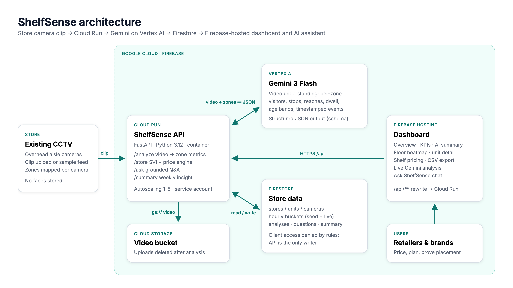

# ShelfSense

**AI that turns a store's existing CCTV into a price tag for every shelf.**

Brands pay retailers for end-caps, eye-level slots and promotional bays, but that space is priced by position and negotiation, not by how many shoppers actually see it. ShelfSense watches store camera footage with Gemini, measures per shelf zone who walks past, who stops and who reaches, and turns that into a **Shelf Value Index (SVI)** and a suggested monthly rent for every shelf.

- **Live prototype:** https://shelfsense-demo.web.app
- **Demo video (3:23):** https://youtu.be/9HP-f7Th4XY
- **Pitch deck:** [docs/ShelfSense-pitch-deck.pptx](docs/ShelfSense-pitch-deck.pptx)
- **API (Cloud Run):** https://shelfsense-demo.web.app/api/health



## What it does

| Feature | How |
|---|---|
| Video → shelf metrics | A store clip goes to **Gemini 3 Flash on Vertex AI**. With a zone-aware prompt and a JSON response schema, Gemini returns per-zone unique visitors, stops, reaches, median dwell, age bands and a timestamped event log. |
| Shelf Value Index | `Base = 0.40·F + 0.25·S + 0.20·R + 0.15·D` (footfall, stop rate, reach rate, dwell, each robust min-max normalised P5–P95 within the store); `SVI = 100 · Base · AudienceFit`. |
| Brand audience view | AudienceFit re-weights SVI by how well a shelf's shopper age mix matches a brand's target (clipped 0.5–1.5×). |
| Pricing | `Price = base rate × SVI ÷ store median SVI`, floor 40% of base rate. |
| Ask ShelfSense | Natural-language Q&A answered by Gemini, grounded only on the store's Firestore data, citing shelf ids. |
| Weekly summary | Gemini writes a four-point manager brief: most valuable shelf, under-priced opportunity, peak window, one action. |
| Privacy | Uploaded video is deleted right after analysis (plus a 1-day bucket lifecycle rule). Only anonymous counts are stored. Gemini is instructed never to identify people. |

## How it uses Firebase, Firestore, Cloud Run and Gemini

- **Firebase Hosting** serves the dashboard (`web/`) and rewrites `/api/**` to the Cloud Run service, so the app is one origin.
- **Firestore** is the system of record: `stores/{id}` with `units`, `cameras`, hourly `buckets` (simulated history plus live Gemini rows), `analyses`, `questions` and the cached `meta/summary`. Firestore rules deny all direct client access; the API is the only writer.
- **Cloud Run** runs the FastAPI service (`backend/`) under a dedicated service account with `aiplatform.user`, `datastore.user` and bucket-scoped storage access.
- **Gemini (Vertex AI)** does three jobs: video understanding of shelf zones (structured output), grounded Q&A, and the weekly summary.

## Repository layout

```
backend/        FastAPI service (Cloud Run)
  main.py       endpoints, Firestore access, live bucket writes
  ai.py         Gemini calls: video analysis schema, Q&A, summary
  svi.py        Shelf Value Index + pricing engine
  store_config.py  demo store, cameras, zones, simulated 7-day history
web/            dashboard (Firebase Hosting), vanilla JS + Plotly
samples/clips/  four demo camera clips (Pexels stock footage)
scripts/deploy.sh  one-shot deploy of everything
docs/           architecture diagram, screenshots
```

## Run it yourself

```bash
# Needs: gcloud + firebase CLIs, a GCP project with billing
./scripts/deploy.sh <project-id>
```

The script enables the APIs, creates Firestore and the video bucket, uploads the sample clips, deploys the API to Cloud Run and the dashboard to Firebase Hosting. Change the `site` in `firebase.json` to your own Hosting site.

Local development of the scoring engine:

```bash
python3 -m venv .venv && .venv/bin/pip install -r backend/requirements.txt
cd backend && ../.venv/bin/python -c "import svi, store_config as s; print(svi.score(s.seed_buckets(), s.UNITS, 25000)[:3])"
```

## API

| Method | Path | Purpose |
|---|---|---|
| GET | `/api/store?audience=generic\|18-35\|35-55\|families\|55+` | KPIs, SVI ranking, prices, heatmap, summary |
| GET | `/api/units/{id}` | Unit detail: inputs, hour × weekday heatmap, peaks |
| POST | `/api/analyze` | `camera_id` + optional `video` file → Gemini analysis, written to Firestore |
| GET | `/api/analyses` | Recent analyses |
| POST | `/api/ask` | `{question, history}` → grounded answer |
| POST | `/api/summary` | Regenerate the weekly summary |

## Honest notes on the prototype

- The 7-day store history is **simulated** (tagged `source: "seed"`) so the dashboard has a week of shape to show. Every Gemini run adds real rows tagged `source: "gemini"`, visible as "live" in the pricing table.
- The demo clips are stock footage, not real store CCTV. Gemini works from short clips; the production design (see the technical design document) moves detection and tracking to an in-store edge box and sends only counts to the cloud.
- SVI weights are the documented defaults. A pilot would calibrate them against point-of-sale data.

Built for the AI Builder Cup.
